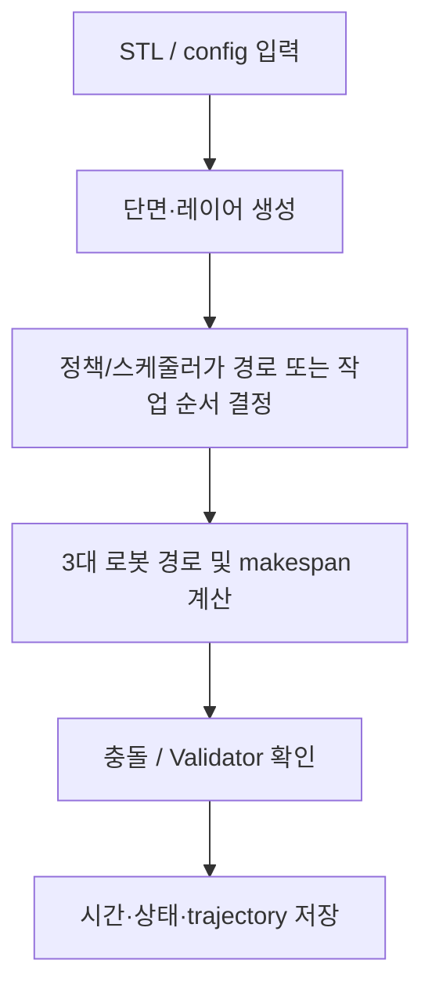

# 알고리즘 4 — Beta territory 직접 경로 prototype 결과 정리

## 제출 정보

| 항목 | 기입 |
|---|---|
| 이름 | ______________________________ |
| 학번 | ______________________________ |
| GitHub 링크 | ______________________________ |

## 적용 결과

제공한 six STL 중 train/01에 대해 rules-based compacted schedule을 실행한 full Validator result가 있다. 별도 Beta PPO training run은 interrupted였고, 이를 학습된 결과로 보고하지 않는다. 나머지 다섯 입력은 미측정.

입력한 모델명은 이 자료 묶음에서 `train/01`~`train/06` 입력 ID와 순서대로 연결했다. STL 파일 자체에는 별칭 메타데이터가 없어, 최종 제출 전에 이름과 STL의 대응을 확인한다.

| 모델 | Makespan (DD:HH:MM:SS) | 계산 시간 (DD:HH:MM:SS) | Validator |
|---|---:|---:|---|
| 01 (Honeycomb) | 00:00:35:04 | 00:00:01:32 | PASS |
| 02 (Spiral) | 미측정 | 미측정 | 미측정 |
| 03 (Triangular truss) | 미측정 | 미측정 | 미측정 |
| 04 (Motor inner) | 미측정 | 미측정 | 미측정 |
| 05 (Twisted shell) | 미측정 | 미측정 | 미측정 |
| 06 (Angle frame) | 미측정 | 미측정 | 미측정 |

`Makespan`은 로봇 스케줄의 경과 시간이고, `계산 시간`은 저장된 실행에서 해당 작업을 계산한 벽시계 시간이다. 원본 로그가 제공하지 않은 수치는 추정하지 않았다. `미측정`은 실패를 뜻하지 않으며, 해당 모델의 결과 파일이 없다는 뜻이다.

## 알고리즘 설명

**알고리즘:** 영역을 nearest reachable robot에 고정 배정하고, layer-wide 직접 좌표 PPO action을 scheduler에 연결

**이 문제에 적용한 이유:** 각 레이어의 target 단면을 base가 가장 가까운 도달 가능 로봇에게 고정 배정하고, 충돌이면 해당 로봇의 다른 미완료 작업을 먼저 선택한다.

**처리 흐름:**

**보상 및 목적:** prototype reward: IoU−0.1×layer time×idle factor/reference; final whole Validator PASS +1, FAIL −1, invalid route −2. Exact formula and units in Beta README.

**학습 설정:** PPO 요청값 1,024 timesteps, CUDA, gamma=.99, GAE=.95, lr=3e-4, batch=32, seed=42; run status interrupted. Rule-based demo/training test scores are separate.

**특징과 장점:** 분리 데모에서 Validator PASS 및 82.92초 3대 동시 D가 확인됨. 영역·Gantt·trajectory artifacts exist.

**한계:** Demo action is rule-based and is not a trained Beta PPO result. train/01 compacted run has 0 seconds simultaneous deposition; high-dimensional direct-coordinate PPO remained interrupted. Results do not support claiming six-model PPO performance.

## 캡처와 원본 증거

실제 WAAM Validator는 [train/01 report](../../Beta/result/plans/train_01_compacted/job_00/episode_000/validation/validation_report.md) 및 [요약 JSON](../../Beta/result/plans/train_01_compacted/job_00/episode_000/validation/summary.json)에 있다. [Gantt](../../Beta/result/plans/train_01_compacted/gantt/index.html), [territories HTML](../../Beta/result/plans/train_01_compacted/territories.html)와 [PPO training record](../../Beta/result/training/layers_Beta_20261018_141910_632702/training.json)도 보관한다. train/01의 rules-based run은 PASS, makespan 2,104.94초, 계산 92.48초, 2+대 동시 적층 0초다. 분리 영역 데모는 3대 동시 D 82.92초 PASS지만 제출 STL 평가는 아니다. PPO training run은 `interrupted`; 그 PASS와 혼동하지 않는다.

## 포함 파일

- `model_results.csv`: 표의 원시 초 단위 수치와 표시용 시각.
- 이 보고서와 아래 연결된 Validator 요약, trajectory, Gantt 및 학습 메타데이터.
- 별도 UI 캡처가 없는 실행은 실제 Validator의 `summary.json`/`validation_report.md`를 증거로 삼는다. 이를 UI 스크린샷으로 표시하지 않는다.
