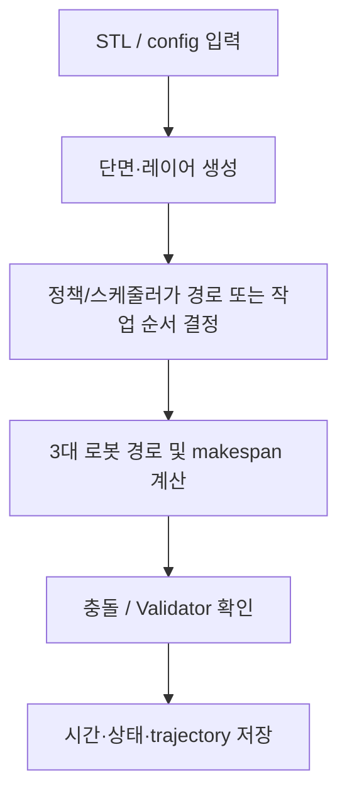

# 알고리즘 2 — Minor placement·scheduler PPO 결과 정리

## 제출 정보

| 항목 | 기입 |
|---|---|
| 이름 | ______________________________ |
| 학번 | ______________________________ |
| GitHub 링크 | ______________________________ |

## 적용 결과

동일한 원본 1.0.2 action을 사용한 스케줄 비교는 train/01·02 두 STL만 있다. 이 측정은 scheduler 개선 효과이고, 학습된 Minor 정책의 6개 STL 성능 표가 아니다. CUDA 통합 smoke는 별도 2-step 연결 시험이다.

입력한 모델명은 이 자료 묶음에서 `train/01`~`train/06` 입력 ID와 순서대로 연결했다. STL 파일 자체에는 별칭 메타데이터가 없어, 최종 제출 전에 이름과 STL의 대응을 확인한다.

| 모델 | Makespan (DD:HH:MM:SS) | 계산 시간 (DD:HH:MM:SS) | Validator |
|---|---:|---:|---|
| 01 (Honeycomb) | 00:00:34:48 | 00:00:00:12 | PASS |
| 02 (Spiral) | 00:01:09:26 | 00:00:00:24 | PASS |
| 03 (Triangular truss) | 미측정 | 미측정 | 미측정 |
| 04 (Motor inner) | 미측정 | 미측정 | 미측정 |
| 05 (Twisted shell) | 미측정 | 미측정 | 미측정 |
| 06 (Angle frame) | 미측정 | 미측정 | 미측정 |

`Makespan`은 로봇 스케줄의 경과 시간이고, `계산 시간`은 저장된 실행에서 해당 작업을 계산한 벽시계 시간이다. 원본 로그가 제공하지 않은 수치는 추정하지 않았다. `미측정`은 실패를 뜻하지 않으며, 해당 모델의 결과 파일이 없다는 뜻이다.

## 알고리즘 설명

**알고리즘:** 경로 PPO와 STL 전체 평행이동 PPO를 번갈아 학습하고, 충돌 안전 스케줄 후보를 탐색

**이 문제에 적용한 이유:** 세 로봇의 선분 순서를 유지하며 home 왕복·작업 순서·안전한 시작 시각을 탐색한다. 추가 네트워크는 STL 전체를 한 번 같은 XY 이동으로 평행 이동한 뒤 슬라이싱한다.

**처리 흐름:**

**보상 및 목적:** 동일 path action schedule 비교에서는 별도 PPO reward update가 없고, 평가 목표는 makespan/충돌/전체 Validator. Full policy reward와 optimizer 설정은 README와 training metadata에 기록.

**학습 설정:** 보고된 두 입력은 train/01(6 layers), train/02(8 layers). 실제 학습 설정과 두 PPO 업데이트는 `Minor/README.md` 및 각 run `training.json` 참고. Short dual-CUDA connection run: path 2 steps + placement 2 STL episodes.

**특징과 장점:** 01·02에서 전체 Validator PASS와 적층선 보존을 확인했고, home 왕복을 줄이는 local schedule을 만들었다.

**한계:** six named STL의 완전한 Minor PPO 학습·평가가 없고, 보고된 pair 비교 두 입력을 나머지 모델 결과처럼 일반화할 수 없다. 3대 동시 적층은 모든 크기에서 보장되지 않는다.

## 캡처와 원본 증거

## 측정된 원본 입력

- train/01: [원본 Gantt](../../Minor/result/benchmark/full_01_02/job_00_01/before_gantt.html) · [Minor Gantt](../../Minor/result/benchmark/full_01_02/job_00_01/after_gantt.html) · [Validator 요약](../../Minor/result/benchmark/full_01_02/job_00_01/after/validation/validation_report.md)
- train/02: [원본 Gantt](../../Minor/result/benchmark/full_01_02/job_01_02/before_gantt.html) · [Minor Gantt](../../Minor/result/benchmark/full_01_02/job_01_02/after_gantt.html) · [Validator 요약](../../Minor/result/benchmark/full_01_02/job_01_02/after/validation/validation_report.md)

- [모든 측정 비교](../../Minor/RESULTS.md) · [세부 JSON](../../Minor/result/benchmark/full_01_02/comparison.json) · [CUDA 연결 점검 설정](../../Minor/result/integration/dual_cuda_verified/training.json)

## 포함 파일

- `model_results.csv`: 표의 원시 초 단위 수치와 표시용 시각.
- 이 보고서와 아래 연결된 Validator 요약, trajectory, Gantt 및 학습 메타데이터.
- 별도 UI 캡처가 없는 실행은 실제 Validator의 `summary.json`/`validation_report.md`를 증거로 삼는다. 이를 UI 스크린샷으로 표시하지 않는다.
