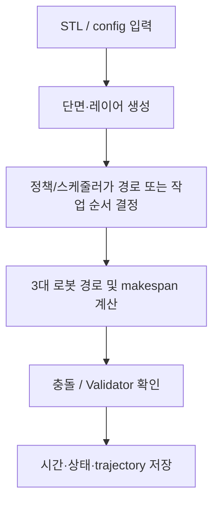

# 알고리즘 1 — 기본 1.0.2 Layer PPO 결과 정리

## 제출 정보

| 항목 | 기입 |
|---|---|
| 이름 | ______________________________ |
| 학번 | ______________________________ |
| GitHub 링크 | ______________________________ |

## 적용 결과

six STL 전체에 대한 저장된 평가를 정리했다. 결과 평가 6/6 PASS이며, 이 실행은 1,024 layer step 학습 모델이다. 비교 실험의 학습·검증 구성은 별도 원본 JSON에 기록되어 있다.

입력한 모델명은 이 자료 묶음에서 `train/01`~`train/06` 입력 ID와 순서대로 연결했다. STL 파일 자체에는 별칭 메타데이터가 없어, 최종 제출 전에 이름과 STL의 대응을 확인한다.

| 모델 | Makespan (DD:HH:MM:SS) | 계산 시간 (DD:HH:MM:SS) | Validator |
|---|---:|---:|---|
| 01 (Honeycomb) | 00:00:42:57 | 00:00:00:07 | PASS |
| 02 (Spiral) | 00:01:28:31 | 00:00:00:12 | PASS |
| 03 (Triangular truss) | 00:01:07:50 | 00:00:00:05 | PASS |
| 04 (Motor inner) | 00:20:06:15 | 00:00:01:07 | PASS |
| 05 (Twisted shell) | 05:01:23:21 | 00:00:08:35 | PASS |
| 06 (Angle frame) | 00:02:40:19 | 00:00:00:23 | PASS |

`Makespan`은 로봇 스케줄의 경과 시간이고, `계산 시간`은 저장된 실행에서 해당 작업을 계산한 벽시계 시간이다. 원본 로그가 제공하지 않은 수치는 추정하지 않았다. `미측정`은 실패를 뜻하지 않으며, 해당 모델의 결과 파일이 없다는 뜻이다.

## 알고리즘 설명

**알고리즘:** Stable-Baselines3 PPO, 레이어 경로 매개변수 선택

**이 문제에 적용한 이유:** STL의 각 layer에서 적층 각도·간격·시작점·선분 순서와 로봇 partition을 한 행동으로 선택한다. 세 로봇의 schedule을 만들고 공식 WAAM Validator에서 전체 trajectory와 형상을 확인한다.

**처리 흐름:**

**보상 및 목적:** 정상 layer: `R = IoU − 0.1 × layer_duration × idle_factor / T_ref`, 여기서 `idle_factor = 1 + sum(robot_idle_time)/layer_duration` (3대면 평균 utilization 1대: 3, 3대: 1). 최종 layer에 `+1` official Validator PASS 또는 `−1` FAIL/ERROR. 경로/도달/충돌 거부는 `−2`.

**학습 설정:** MlpPolicy; 1,024 training timesteps; CUDA PPO; n_steps=64, batch=32, learning rate=3e-4, gamma=.99, GAE=.95, seed=42. Geometry/Validator는 CPU.

**특징과 장점:** 출력은 layer 단위라 경로 선택과 검증을 추적하기 쉽다. 6개 실제 STL 결과와 Validator 보고서, trajectory, Gantt가 저장되어 있다.

**한계:** 단일 seed와 제한된 timestep이며 수렴·일반화를 보장하지 않는다. STL 05의 평가만 515초가 넘어 산출 형상 크기에 따라 시간이 크게 다르다.

## 캡처와 원본 증거

## Validator·Gantt·모델 파일

- 01 (Honeycomb): [Validator 보고서](../../result/layer_evaluation/stl_files_20261017_trained_model_runtime/job_00/episode_000/validation/validation_report.md) · [결과 요약 JSON](../../result/layer_evaluation/stl_files_20261017_trained_model_runtime/job_00/episode_000/validation/summary.json)
- 02 (Spiral): [Validator 보고서](../../result/layer_evaluation/stl_files_20261017_trained_model_runtime/job_01/episode_000/validation/validation_report.md) · [결과 요약 JSON](../../result/layer_evaluation/stl_files_20261017_trained_model_runtime/job_01/episode_000/validation/summary.json)
- 03 (Triangular truss): [Validator 보고서](../../result/layer_evaluation/stl_files_20261017_trained_model_runtime/job_02/episode_000/validation/validation_report.md) · [결과 요약 JSON](../../result/layer_evaluation/stl_files_20261017_trained_model_runtime/job_02/episode_000/validation/summary.json)
- 04 (Motor inner): [Validator 보고서](../../result/layer_evaluation/stl_files_20261017_trained_model_runtime/job_03/episode_000/validation/validation_report.md) · [결과 요약 JSON](../../result/layer_evaluation/stl_files_20261017_trained_model_runtime/job_03/episode_000/validation/summary.json)
- 05 (Twisted shell): [Validator 보고서](../../result/layer_evaluation/stl_files_20261017_trained_model_runtime/job_04/episode_000/validation/validation_report.md) · [결과 요약 JSON](../../result/layer_evaluation/stl_files_20261017_trained_model_runtime/job_04/episode_000/validation/summary.json)
- 06 (Angle frame): [Validator 보고서](../../result/layer_evaluation/stl_files_20261017_trained_model_runtime/job_05/episode_000/validation/validation_report.md) · [결과 요약 JSON](../../result/layer_evaluation/stl_files_20261017_trained_model_runtime/job_05/episode_000/validation/summary.json)

- [Gantt 모음](../../result/layer_evaluation/stl_files_20261017_trained_model_runtime/gantt/index.html) · [평가 원본 JSON](../../result/layer_evaluation/stl_files_20261017_trained_model_runtime/evaluation.json) · [학습 metadata](../../result/training/layers_1.0.2_20261017_044941_396096/training.json)

Makespan 합계는 88,492.75초이며 6개 STL에 대한 합이다. 계산 시간 합은 630초 수준이나, 실행별 병렬 부하 차이가 있어 엄밀한 속도 벤치마크로 비교하지 않는다.

## 포함 파일

- `model_results.csv`: 표의 원시 초 단위 수치와 표시용 시각.
- 이 보고서와 아래 연결된 Validator 요약, trajectory, Gantt 및 학습 메타데이터.
- 별도 UI 캡처가 없는 실행은 실제 Validator의 `summary.json`/`validation_report.md`를 증거로 삼는다. 이를 UI 스크린샷으로 표시하지 않는다.
