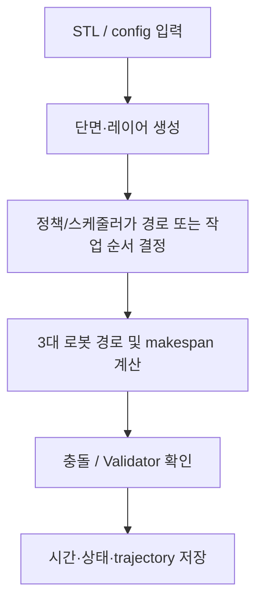

# 알고리즘 6 — minor3 path + avoidance PPO 결과 정리

## 제출 정보

| 항목 | 기입 |
|---|---|
| 이름 | ______________________________ |
| 학번 | ______________________________ |
| GitHub 링크 | ______________________________ |

## 적용 결과

제공한 6개 full-size STL에는 run 없음. 저장된 별도 compact validation 6개는 complete 및 sampled collision-free지만 IoU/full WAAM Validator는 실행하지 않았다.

입력한 모델명은 이 자료 묶음에서 `train/01`~`train/06` 입력 ID와 순서대로 연결했다. STL 파일 자체에는 별칭 메타데이터가 없어, 최종 제출 전에 이름과 STL의 대응을 확인한다.

| 모델 | Makespan (DD:HH:MM:SS) | 계산 시간 (DD:HH:MM:SS) | Validator |
|---|---:|---:|---|
| 01 (Honeycomb) | 미측정 | 미측정 | Validator 미실행 |
| 02 (Spiral) | 미측정 | 미측정 | Validator 미실행 |
| 03 (Triangular truss) | 미측정 | 미측정 | Validator 미실행 |
| 04 (Motor inner) | 미측정 | 미측정 | Validator 미실행 |
| 05 (Twisted shell) | 미측정 | 미측정 | Validator 미실행 |
| 06 (Angle frame) | 미측정 | 미측정 | Validator 미실행 |

`Makespan`은 로봇 스케줄의 경과 시간이고, `계산 시간`은 저장된 실행에서 해당 작업을 계산한 벽시계 시간이다. 원본 로그가 제공하지 않은 수치는 추정하지 않았다. `미측정`은 실패를 뜻하지 않으며, 해당 모델의 결과 파일이 없다는 뜻이다.

## 알고리즘 설명

**알고리즘:** PPO path 정책과 충돌 지점 대피 정책을 교대 학습

**이 문제에 적용한 이유:** 한 PPO 행동으로 layer 전체 경로를 만들고, 별도 PPO가 predicted XY collision에서 로봇·대피 방향·거리·대기·복귀 행동을 선택한다. 적층 중간에서도 같은 D 선분을 끊었다 이어갈 수 있게 설계했다.

**처리 흐름:**

**보상 및 목적:** path: −final makespan/T_ref. avoidance: −(new makespan−old makespan)/T_ref, gamma=1. No IoU/Validator bonus.

**학습 설정:** CUDA, 40 alternating updates, path 80 steps, avoidance 320 repair steps, seed 42; both policies trainable; 18 selected layers; early stopping off; total 2,401.2 sec.

**특징과 장점:** Both trained actors changed; six compact validation schedules collision-free; saved deterministic trajectory and repair traces.

**한계:** Six compact result makespan sum rose 11.07% vs pretraining. A larger STL replay failed after 32 repairs. No official Validator/IoU claim; a sampled collision check is not whole geometry validation.

## 캡처와 원본 증거

## 별도 validation STL (전체 Validator 미실행)

| Validation STL | Makespan | 계산 시간 | collision model | 전체 Validator |
|---|---:|---:|---|---|
| 00_sample | 00:00:00:57 | 00:00:00:01 | 충돌 없음 | 미실행 |
| 01_rectangle | 00:00:11:03 | 00:00:00:04 | 충돌 없음 | 미실행 |
| 02_triangle | 00:00:03:23 | 00:00:00:02 | 충돌 없음 | 미실행 |
| 03_l_shape | 00:00:10:39 | 00:00:00:05 | 충돌 없음 | 미실행 |
| 04_cross | 00:00:05:29 | 00:00:00:03 | 충돌 없음 | 미실행 |
| 05_ring | 00:00:06:48 | 00:00:00:04 | 충돌 없음 | 미실행 |

6/6 complete, but the additional large STL 05 layer 174 replay hit repair_limit (32) after 4 mid-D interruptions. It has no complete trajectory. [diagnostic XY plot](../../minor3/result/joint_40updates/mid_stroke_example/xy_detours.html) · [makespan report](../../minor3/result/joint_40updates/RESULTS.md) · [two model weights](../../minor3/result/joint_40updates)

## 포함 파일

- `model_results.csv`: 표의 원시 초 단위 수치와 표시용 시각.
- 이 보고서와 아래 연결된 Validator 요약, trajectory, Gantt 및 학습 메타데이터.
- 별도 UI 캡처가 없는 실행은 실제 Validator의 `summary.json`/`validation_report.md`를 증거로 삼는다. 이를 UI 스크린샷으로 표시하지 않는다.
