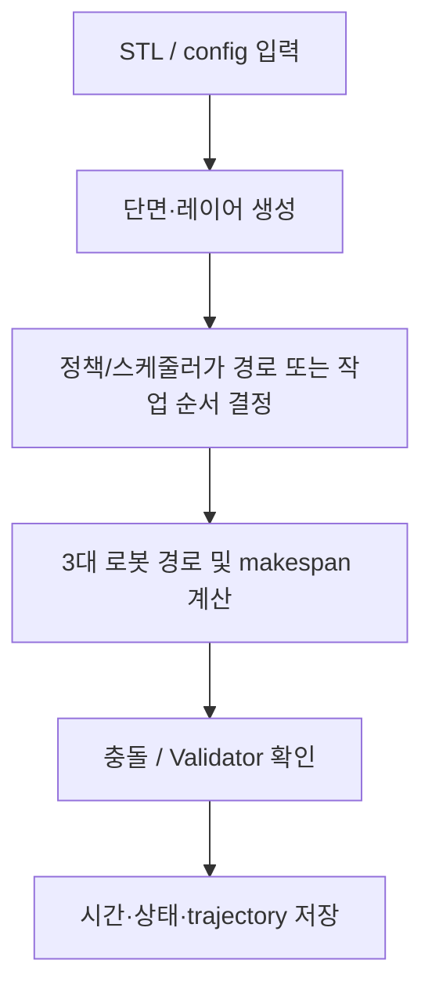

# 알고리즘 3 — minor_2 reward-only PPO 결과 정리

## 제출 정보

| 항목 | 기입 |
|---|---|
| 이름 | ______________________________ |
| 학번 | ______________________________ |
| GitHub 링크 | ______________________________ |

## 적용 결과

train/01~06 동일 STL·config·seed 10042에서 원본과 minor_2를 비교했다. six rows 모두 공식 WAAM Validator PASS.

입력한 모델명은 이 자료 묶음에서 `train/01`~`train/06` 입력 ID와 순서대로 연결했다. STL 파일 자체에는 별칭 메타데이터가 없어, 최종 제출 전에 이름과 STL의 대응을 확인한다.

| 모델 | Makespan (DD:HH:MM:SS) | 계산 시간 (DD:HH:MM:SS) | Validator |
|---|---:|---:|---|
| 01 (Honeycomb) | 00:00:40:50 | 00:00:00:05 | PASS |
| 02 (Spiral) | 00:01:24:34 | 00:00:00:10 | PASS |
| 03 (Triangular truss) | 00:01:06:16 | 00:00:00:06 | PASS |
| 04 (Motor inner) | 00:19:16:04 | 00:00:01:25 | PASS |
| 05 (Twisted shell) | 04:12:27:22 | 00:00:07:14 | PASS |
| 06 (Angle frame) | 00:02:41:07 | 00:00:00:16 | PASS |

`Makespan`은 로봇 스케줄의 경과 시간이고, `계산 시간`은 저장된 실행에서 해당 작업을 계산한 벽시계 시간이다. 원본 로그가 제공하지 않은 수치는 추정하지 않았다. `미측정`은 실패를 뜻하지 않으며, 해당 모델의 결과 파일이 없다는 뜻이다.

## 알고리즘 설명

**알고리즘:** 원본 layer-path PPO 가중치에서 시작한 단일 PPO; 변경점은 보상식

**이 문제에 적용한 이유:** 각 step은 한 layer 전체 경로를 고른다. IoU가 0.9 초과이면 `10 × 평균 D 활용률 × T_ref / layer makespan`; 그 외에는 terminal whole-STL Validator PASS/FAIL 보상을 적용한다.

**처리 흐름:**

**보상 및 목적:** 고 IoU 시간 경로는 makespan이 짧고 적층 사용률이 높은 방향의 보상을 받고, 낮은 IoU에서는 공식 Validator terminal 결과로 학습한다.

**학습 설정:** 40 PPO updates × 64 steps = 2,560 layer steps; CUDA; seed 42; gamma=.99; GAE=.95; lr=3e-4; batch=32; eval 4 updates마다; target_kl 미사용. 학습 2,494.29초.

**특징과 장점:** six input set 전체, per-robot T/D/W 활용률, Gantt PNG/PDF, 공식 Validator PASS 기록 및 같은 hash의 전후 비교가 있다.

**한계:** 비용 높은 고IoU branch는 Validator terminal reward에 기대지 않는다. 단일 seed 및 한 번의 40-update 결과이며, sixth model makespan은 약 0.50% 늘었다.

## 캡처와 원본 증거

## Gantt 캡처 및 Validator 기록

- 01 (Honeycomb): [Gantt PNG](captures/gantt_01.png) · [전/후 Gantt HTML](../../minor_2/result/training/reward_only_40updates_20261018_155838/comparison/robot_utilization_report/robot_utilization_comparison.html)
- 02 (Spiral): [Gantt PNG](captures/gantt_02.png) · [전/후 Gantt HTML](../../minor_2/result/training/reward_only_40updates_20261018_155838/comparison/robot_utilization_report/robot_utilization_comparison.html)
- 03 (Triangular truss): [Gantt PNG](captures/gantt_03.png) · [전/후 Gantt HTML](../../minor_2/result/training/reward_only_40updates_20261018_155838/comparison/robot_utilization_report/robot_utilization_comparison.html)
- 04 (Motor inner): [Gantt PNG](captures/gantt_04.png) · [전/후 Gantt HTML](../../minor_2/result/training/reward_only_40updates_20261018_155838/comparison/robot_utilization_report/robot_utilization_comparison.html)
- 05 (Twisted shell): [Gantt PNG](captures/gantt_05.png) · [전/후 Gantt HTML](../../minor_2/result/training/reward_only_40updates_20261018_155838/comparison/robot_utilization_report/robot_utilization_comparison.html)
- 06 (Angle frame): [Gantt PNG](captures/gantt_06.png) · [전/후 Gantt HTML](../../minor_2/result/training/reward_only_40updates_20261018_155838/comparison/robot_utilization_report/robot_utilization_comparison.html)

- [원본/ minor_2 비교 PDF](captures/minor2_robot_utilization_and_gantt.pdf) · [원본 CSV](../../minor_2/result/training/reward_only_40updates_20261018_155838/comparison/original_gantt_comparison.csv) · [학습 설정](../../minor_2/result/training/reward_only_40updates_20261018_155838/training.json)

전체 makespan 530,956.53초 → 480,975.40초 (9.41% 감소). 계산시간 합 631.28초 → 558.57초. 이 시간은 개별 평가 run의 수치 합이며 다른 branch와 직접 속도비교하지 않는다.

## 포함 파일

- `model_results.csv`: 표의 원시 초 단위 수치와 표시용 시각.
- 이 보고서와 아래 연결된 Validator 요약, trajectory, Gantt 및 학습 메타데이터.
- 별도 UI 캡처가 없는 실행은 실제 Validator의 `summary.json`/`validation_report.md`를 증거로 삼는다. 이를 UI 스크린샷으로 표시하지 않는다.
