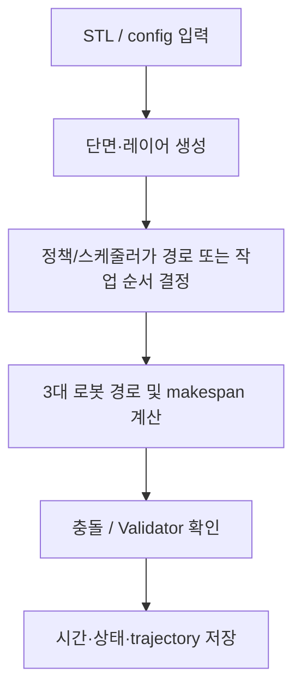

# 알고리즘 5 — local conflict repair scheduler PPO 결과 정리

## 제출 정보

| 항목 | 기입 |
|---|---|
| 이름 | ______________________________ |
| 학번 | ______________________________ |
| GitHub 링크 | ______________________________ |

## 적용 결과

요청한 train/01~06 전체의 scheduler 적용 시간이 저장돼 있지 않으므로 해당 표는 미측정이다. 아래 compact validation 6종은 별도 입력으로, full Validator를 통과했다.

입력한 모델명은 이 자료 묶음에서 `train/01`~`train/06` 입력 ID와 순서대로 연결했다. STL 파일 자체에는 별칭 메타데이터가 없어, 최종 제출 전에 이름과 STL의 대응을 확인한다.

| 모델 | Makespan (DD:HH:MM:SS) | 계산 시간 (DD:HH:MM:SS) | Validator |
|---|---:|---:|---|
| 01 (Honeycomb) | 미측정 | 미측정 | 미측정 |
| 02 (Spiral) | 미측정 | 미측정 | 미측정 |
| 03 (Triangular truss) | 미측정 | 미측정 | 미측정 |
| 04 (Motor inner) | 미측정 | 미측정 | 미측정 |
| 05 (Twisted shell) | 미측정 | 미측정 | 미측정 |
| 06 (Angle frame) | 미측정 | 미측정 | 미측정 |

`Makespan`은 로봇 스케줄의 경과 시간이고, `계산 시간`은 저장된 실행에서 해당 작업을 계산한 벽시계 시간이다. 원본 로그가 제공하지 않은 수치는 추정하지 않았다. `미측정`은 실패를 뜻하지 않으며, 해당 모델의 결과 파일이 없다는 뜻이다.

## 알고리즘 설명

**알고리즘:** 고정 minor_2 deposition action에 충돌 예측·작업 재정렬·국소 대피만 학습하는 masked PPO

**이 문제에 적용한 이유:** 충돌이 예상되면 실행 중인 적층선을 끊지 않고, 작업 경계에서 유휴 로봇을 XY 대피시키거나 기다린다. 전체 후보 schedule을 공식 충돌 geometry로 다시 확인한다.

**처리 흐름:**

**보상 및 목적:** `r_step = ΔD / total_D − Δt / T_ref − 0.02 × yield_distance_m`; terminal `+10 × mean_D_utilization × T_ref / makespan`; failure `−10`.

**학습 설정:** CUDA, 40 updates × 64 steps=2,560 scheduler steps, 18 selected training layers, validation 6 compact STL full layers, no early stopping. minor_2 path model frozen.

**특징과 장점:** compact validation 6/6 PASS; 같은 frozen path model에서 makespan 전후·T/D/W·대피 회수를 비교하고, 로봇 동작 경계를 유지한다.

**한계:** minor_2 makespan 합보다 최종 모델이 4.39% 길었다. 입력이 small validation STLs이고 한 seed/40 updates여서 크고 다른 STL의 일반화 결과는 아니다.

## 캡처와 원본 증거

## 별도 validation STL (실험 입력 01–06과 다른 데이터)

| Validation STL | Makespan | 계산 시간 | Validator |
|---|---:|---:|---|
| 00_sample | 00:00:01:06 | 00:00:00:02 | PASS |
| 01_rectangle | 00:00:09:53 | 00:00:00:19 | PASS |
| 02_triangle | 00:00:03:48 | 00:00:00:09 | PASS |
| 03_l_shape | 00:00:09:34 | 00:00:00:20 | PASS |
| 04_cross | 00:00:05:32 | 00:00:00:24 | PASS |
| 05_ring | 00:00:06:25 | 00:00:00:35 | PASS |

- [상세 보고서](../../scheduler/result/local_repair_40updates/RESULTS.md) · [Gantt](../../scheduler/result/local_repair_40updates/gantt_index.html) · [training parameters](../../scheduler/result/local_repair_40updates/training.json) · official Validator reports: `validation_after/job_XX/validation/validation_report.md`.
- validation makespan 합계 2,181.15초, 6/6 PASS. 이는 제공한 01–06 full-size STL 실험 결과와 동일하지 않다.

## 포함 파일

- `model_results.csv`: 표의 원시 초 단위 수치와 표시용 시각.
- 이 보고서와 아래 연결된 Validator 요약, trajectory, Gantt 및 학습 메타데이터.
- 별도 UI 캡처가 없는 실행은 실제 Validator의 `summary.json`/`validation_report.md`를 증거로 삼는다. 이를 UI 스크린샷으로 표시하지 않는다.
